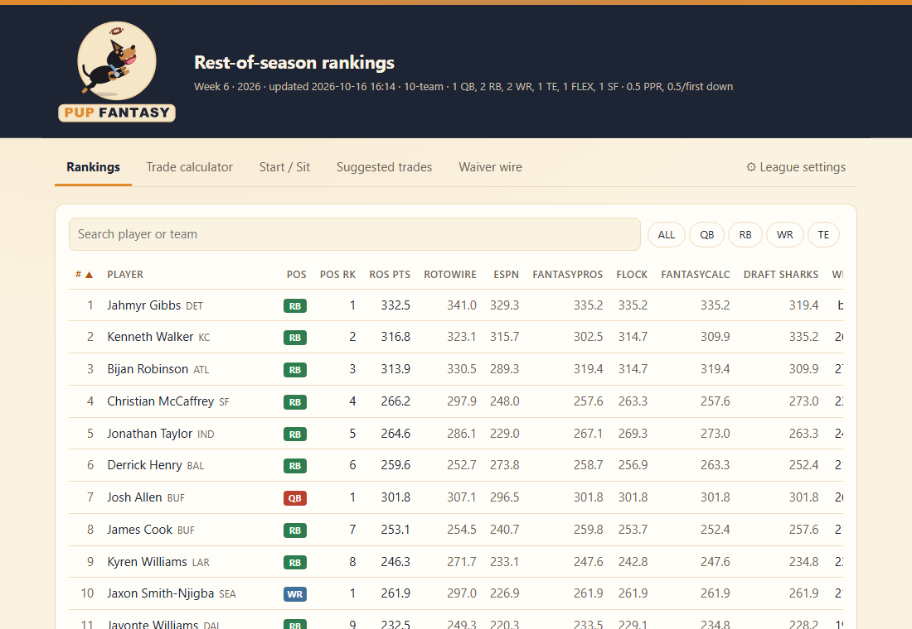
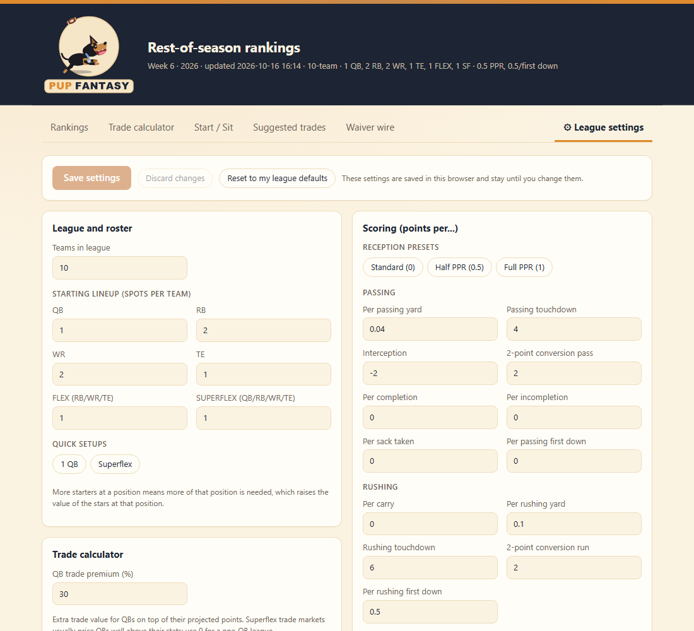
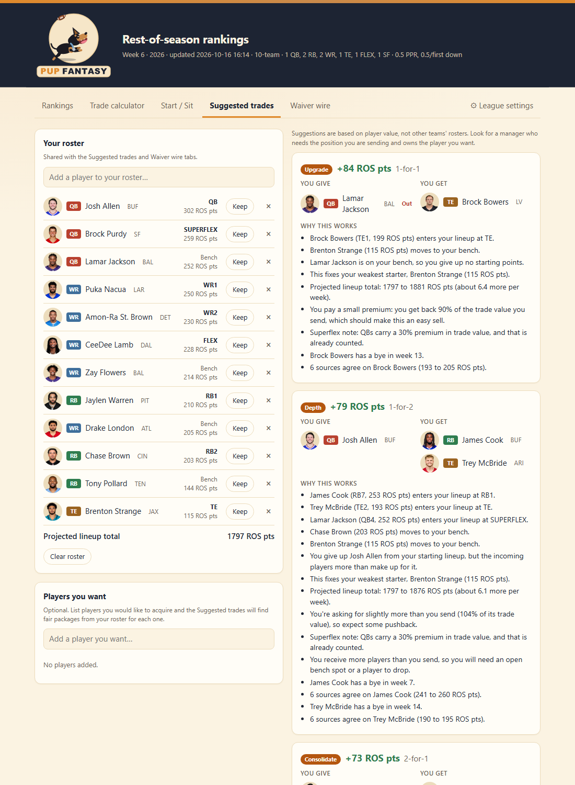

<p align="center">
  
</p>

# Pup Fantasy

A fantasy football **rest-of-season rankings site** that blends projections and rankings from six public sources and re-scores them for *your* league. Every feature (rankings, trades, start/sit, waivers) updates when you change your scoring or roster rules.

It is a static site, plain HTML, CSS and JavaScript with no build step, plus a Python script that refreshes the data.



## Features

- **Rankings.** Rest-of-season points per player, averaged across sources, with each source's number shown. Players are ranked by *value over replacement*, so a top QB is compared with the QB you could pick up, not with a RB.
- **League settings.** Teams, starting lineup (QB / RB / WR / TE / FLEX / SUPERFLEX) and per-stat scoring: points per reception, TE premium, first downs, passing and rushing yards, TDs, completions, sacks and more. Changes are applied when you click **Save**, and they are remembered in your browser.
- **Trade calculator.** Add players to both sides and see who comes out ahead, with stars weighted more heavily than depth and a QB premium for superflex leagues.
- **Start / Sit.** Compares two players' projections for the current week, notes the opponent and injury status, and flags when the sources disagree.
- **Suggested trades.** Enter your roster (and, optionally, players you want) and get fair-value trades that improve your starting lineup, each with the reasoning.
- **Waiver wire.** Suggests who to add and who to drop, based on lineup impact, this week's projection and ESPN ownership trends.
- **Animated logo.** A hand-built SVG of a dog catching a football (`assets/logo.svg`), pure CSS animation, respects `prefers-reduced-motion`.

| League settings | Suggested trades |
| --- | --- |
|  |  |

## How it works

```
update_data.py  ->  data/data.js  ->  index.html
 (fetch, validate)   (raw stat lines      (re-scores, blends and ranks
                      + source ranks)      in the browser)
```

1. `update_data.py` (Python standard library only) fetches each source and writes `data/data.js`. Instead of finished points, the file carries the **raw projected stat lines** and each source's **ranks**.
2. The page loads that file and does the scoring itself (`recompute()` in `index.html`). Projection sources (Rotowire, ESPN) are scored exactly with your rules. Rank-only sources (FantasyPros, Flock, FantasyCalc, Draft Sharks) are mapped onto your scoring through the points curve of the projection sources, then everything is averaged.
3. Replacement levels come from your league size and lineup, which is what makes superflex QBs, TE premiums and deep leagues behave correctly.

**Resilient by design.** Each source is validated and saved as a "last good" copy. If a site changes its layout or goes down, the updater falls back to the saved copy (for up to 10 days), the page shows a notice, and the build refuses to publish if too few sources work.

## Run it

Requires Python 3.9+ (standard library only).

```bash
python update_data.py     # fetches data and writes data/data.js
```

Then open `index.html` in a browser (it works straight from the file system).

**Daily refresh on Windows:** `powershell -ExecutionPolicy Bypass -File schedule_update.ps1` creates a scheduled task that runs the updater every day at 9:00 AM (PC time).

**League defaults** (scoring, teams, lineup) live at the top of `update_data.py` and can also be changed in the site's League settings tab.

## Project layout

| Path | What it is |
| --- | --- |
| `index.html` | The whole site (HTML, CSS, JS) |
| `update_data.py` | Data fetching, validation and the default blend |
| `assets/logo.svg`, `assets/make_logo.py` | The logo and the script that generates it (`pip install fonttools`) |
| `update_scheduled.bat`, `schedule_update.ps1` | Windows scheduling helpers |
| `CLAUDE.md`, `LOG.md` | Developer notes and a running decision log |

## Data and disclaimer

Rankings and projections come from public pages and APIs of Rotowire (via Sleeper), ESPN, FantasyPros, Flock Fantasy, FantasyCalc and Draft Sharks. This project is not affiliated with any of them. **The generated data is not included in this repository**; run the updater yourself, and please check each site's terms of use before doing so. Player headshots are loaded from ESPN's image host. This is a personal, educational project.

## Built with

Vanilla JavaScript, CSS variables (with a matching dark theme), Python 3, and an SVG/CSS animation. Developed with AI assistance (Claude Code).
